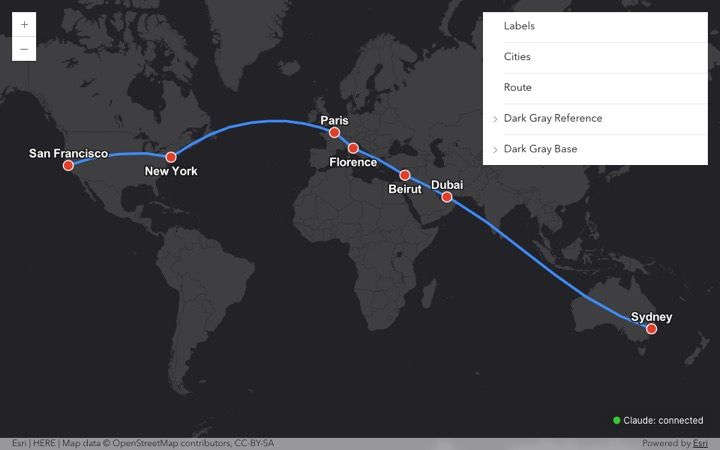

# claude-mod-map

A [Claude Code mod](https://code.claude.com/docs/en/plugins/mods/overview) (`arcgis-map/`) that lets Claude drive a live ArcGIS Maps SDK for JavaScript 5.2 map: add graphics, add layers (feature, GeoJSON, GeoParquet, tile, vector tile, imagery, portal item), zoom, and read map state.

Full documentation: [`docs/index.html`](docs/index.html) (one self-contained HTML file, images inline; download it and open it in a browser).



## Install

Needs Claude Code v2.1.287 or later (mods), macOS, Node.js and Google Chrome. A mod runs with your permissions inside Claude Code: read the code before you install it. At the prompt of a Claude Code terminal session:

```
/plugin install arcgis-map --marketplace mraad/claude-mod-map
```

Type `y` to add the marketplace, then pick a scope. From a shell:

```sh
claude plugin install arcgis-map --marketplace mraad/claude-mod-map
```

## How it works

```
Claude --tool call--> mod (hooks/register.tsx) --POST /cmd--> bridge (web/server.mjs, 127.0.0.1:8765)
                                                                 | SSE /events      ^ POST /ack (result + map state)
                                                                 v                  |
                                                              browser tab: web/index.html (<arcgis-map>, SDK 5.2)
```

- The mod spawns the bridge at session start (`node web/server.mjs 8765`); it stops when the mod unloads.
- Tools: `mcp__arcgis-map__add_graphic`, `add_layer`, `remove_layer`, `clear_graphics`, `go_to`, `map_state`.
- `add_layer` takes `path` (absolute local `.parquet` / `.geojson`): the bridge serves only files passed this way, with HEAD and Range support for Parquet.
- `/map` opens the map **inside the Claude Code pane** (right side; Ghostty, kitty or iTerm2 under fullscreen). The bridge renders the page in headless Chrome (Metal GPU, raw CDP over a pipe, no dependency; `web/viewer.mjs`) and streams PNG frames into the pane's `Image`. Drag to pan, double-click or the map's +/- buttons to zoom; click once, then arrows and `+`/`-` work. The terminal sends no scroll wheel to a pane. Set `CHROME` if Chrome is not at `/Applications/Google Chrome.app`. Chrome stops about 90 s after the pane closes and restarts when it reopens; after a crash it restarts by itself (3 tries), then the pane says why.
- `/map browser` opens the same map as a Chrome app window on the right half of the screen Ghostty is on (its own Chrome profile in the mod's `.browser-profile/`). Full browser map: wheel zoom, sharp picture, layer list. Pane and browser can be open together; every tool updates both.
- Any browser works too: `http://127.0.0.1:8765/`.
- The bridge only answers requests whose Host is `127.0.0.1:8765` and that carry no foreign Origin, so other web pages (and DNS rebinding) cannot reach it. Open the map at `127.0.0.1`, not `localhost`.
- Control endpoints (`/cmd`, `/files`, `/input`) also need a per-load random token that only the mod knows (`ARCGIS_MAP_TOKEN`), and registered file URLs carry random keys, so other local programs cannot drive the map or read files through it. Single-user machine assumed.
- Basemap is OSM (no key). Add `?apiKey=...` to the page URL to use Esri basemap styles.

## Run from this folder (development)

```sh
git clone https://github.com/mraad/claude-mod-map.git && cd claude-mod-map
claude --plugin-dir ./arcgis-map
```

Then `/map` (pane) or `/map browser` (browser window), and ask e.g. "put a blue point on Kuwait City" or "add /path/to/sites.parquet as a layer".

## Check

```sh
claude plugin validate arcgis-map
claude plugin test arcgis-map      # mod: tools, pane, bridge lines, /map
node --test arcgis-map/web/        # bridge, viewer input mapping, real-Chrome viewer test (needs Chrome + network)
```

`docs/demo.mjs` replays the demo in headless Chrome against a running bridge (needs `puppeteer-core`).

## Example

`examples/cities-route.geojson`: one FeatureCollection with seven city Points (Sydney, Dubai, Beirut, Florence, Paris, New York, San Francisco) and one geodesic LineString through them in that order, densified along great circles (32 points per leg, 27,397 km). It is the data behind the screenshot above.

## References

- [Claude Code mods: overview](https://code.claude.com/docs/en/plugins/mods/overview)
- [Claude Code mods: create a mod](https://code.claude.com/docs/en/plugins/mods/create)
- [Claude Code mods: reference](https://code.claude.com/docs/en/plugins/mods/reference) (events, API, limits)
- [ArcGIS Maps SDK for JavaScript](https://developers.arcgis.com/javascript/latest/)
- [RFC 7946: GeoJSON](https://www.rfc-editor.org/rfc/rfc7946)
